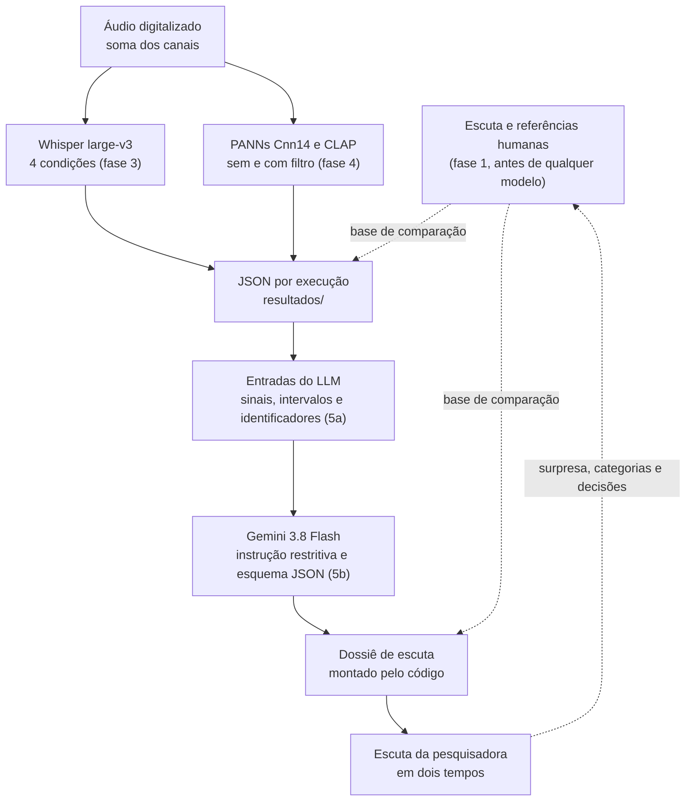

# Escuta cerrada e mediação algorítmica: um protocolo crítico-computacional para registros sonoros de origem mecânica

#### Aluna: [Denise da Silva de Oliveira](https://github.com/denisedeoliveira)
#### Orientador: [Leonardo Alfredo Forero Mendoza](https://github.com/leofome8)

---

Trabalho apresentado ao curso [GenAI e LLM MASTER](https://ica.ele.puc-rio.br/cursos/ia-generativa-large-language-models/) como pré-requisito para conclusão do curso de pós-graduação *Inteligência Artificial Generativa & Large Language Models*.

- Link para o código: [github.com/denisedeoliveira/escuta-cerrada-poc](https://github.com/denisedeoliveira/escuta-cerrada-poc).

- Trabalhos relacionados:
    - [Corpus de áudio da prova de conceito, depositado no Zenodo com acesso restrito](https://doi.org/10.5281/zenodo.23240974).
    - [Protocolo de escuta cerrada com mediação algorítmica](docs/protocolo.md), documento transferível produzido por este trabalho.

---

### Resumo

Este trabalho examina o que um conjunto de modelos de reconhecimento de fala, de detecção de eventos sonoros e de linguagem preserva e o que descarta quando aplicado a cinco gravações em disco de acetato dos anos 1940, preservadas na Coleção da Discoteca Pública do Distrito Federal, sob guarda do Museu da Imagem e do Som do Rio de Janeiro. A prova de conceito inverte o modo habitual de avaliação desses sistemas. Em vez de tomar a escuta humana como fonte de rótulos para treinar ou corrigir a máquina, toma a escuta cerrada de uma pesquisadora especializada como base de comparação, e as divergências entre a máquina e a escuta como resultado a examinar, e não como erro a eliminar. O protocolo foi construído em seis fases, com registro prévio das escutas, das transcrições de referência, das expectativas e de cada desenho experimental antes de qualquer execução. O Whisper large-v3 foi aplicado em quatro condições (com e sem glossário, com e sem filtro de ruído), o PANNs e o CLAP, com e sem filtro, e o Gemini 3.8 Flash recebeu apenas as saídas desses modelos, sob instrução que proíbe interpretar e exige tempo, fonte e grau de apoio, para produzir um dossiê que indique onde escutar. O reconhecimento de fala oscilou entre 5,8% e 95,7% de taxa de erro de palavra, com repetições em laço que os indicadores do próprio modelo não sinalizam. Os detectores nomearam a fala, a música, os aplausos e o vento, cada um a seu modo, e descreveram os sons do suporte e da época por analogia com animais, veículos e armas. O LLM cumpriu as regras sem nenhuma indicação inventada, mas não alcançou os sons de duração, intensidade e materialidade do disco que só a escuta registrou. Em três momentos do percurso, uma representação computacional dirigiu a escuta para algo que ela não havia registrado. O resultado é um protocolo de coescuta em que a máquina indexa a atenção e a decisão sobre o que soa cabe a quem escuta.

### Abstract

This work examines what a chain of speech recognition, sound event detection and language models preserves and discards when applied to five 1940s acetate disc recordings from the Discoteca Pública do Distrito Federal collection, held by the Museu da Imagem e do Som do Rio de Janeiro. The proof of concept inverts the usual evaluation of such systems. Instead of using human listening as a source of labels to train or correct the machine, it takes the close listening of a specialist researcher as the ground of comparison, and treats the divergences between machine and listening as findings to be examined rather than errors to be removed. The protocol was built in six phases, with the listening sessions, reference transcriptions, expectations and each experimental design registered before any model was run. Whisper large-v3 was applied under four conditions (with and without a domain glossary and noise filtering), PANNs and CLAP with and without filtering, and Gemini 3.8 Flash received only the outputs of these models, under an instruction that forbids interpretation and requires time, source and degree of support, to produce a dossier indicating where to listen. Word error rates ranged from 5.8% to 95.7%, with repetition loops that the model's own confidence indicators did not flag. The detectors named speech, music, applause and wind, each in its own way, and described the sounds of the medium and of the period by analogy with animals, vehicles and weapons. The LLM followed the rules without a single fabricated indication, but did not reach the sounds of duration, intensity and disc materiality that only listening had registered. At three points, a computational representation directed listening towards something it had not registered. The result is a co-listening protocol in which the machine indexes attention and the decision about what sounds rests with the listener.

### 1. Introdução

A transcrição costuma ser a primeira forma de acesso a um documento sonoro, nos instrumentos de descrição dos acervos e na pesquisa histórica. Na conversão do registro em texto, fica o conteúdo verbal, deixando-se de lado o ruído do suporte, os gestos de gravação, as pausas, a plateia, a paisagem sonora e os cortes do disco. Com a chegada aos acervos de modelos de reconhecimento de fala e de detecção de eventos sonoros, essa conversão se torna automática e rápida. Nesse contexto, duas perguntas de método se colocam: o que esses modelos preservam e o que descartam quando aplicados a registros sonoros de origem mecânica? E de que modo poderiam participar de uma escuta atenta e especializada, em vez de substituí-la?

A pessoa usuária pensada para o protocolo é a pesquisadora ou o profissional de acervo diante de uma gravação que precisa conhecer. A tarefa atribuída à máquina não é transcrever nem descrever a gravação, mas, sim, indicar, com tempo marcado e fonte declarada, os momentos em que vale escutar com atenção. O critério de sucesso foi fixado antes de qualquer processamento, em 01/10/2026, como “a máquina apontar um evento, com marcação de tempo, que não consta na minha tabela da seção 2 nem na análise da dissertação, e que eu reconheço como presente no áudio ao reescutar o trecho indicado” ([`docs/fase1/05_expectativas.md`](docs/fase1/05_expectativas.md)).

O corpus reúne cinco gravações da primeira metade dos anos 1940, digitalizadas a partir de discos de acetato da Discoteca Pública do Distrito Federal, objeto da dissertação de mestrado da autora (Oliveira, 2020). São elas o discurso de Getúlio Vargas na concentração trabalhista do Pacaembu (1944), a declamação do poema “Dia de verão gaúcho”, de Vargas Neto, a leitura de uma doutrina policial sobre a prostituição (1944), a apresentação dos instrumentos do samba por Almirante e uma faixa inédita, o primeiro ato de uma encenação do descobrimento do Brasil, com texto de C. Paula Barros, escolhida para a escuta cega. Os arquivos não integram o repositório e estão depositados no Zenodo, com acesso restrito (Oliveira, 2026).

A abordagem parte da noção de *close listening*, formulada para a poesia gravada (Bernstein, 1998) e retomada nas humanidades digitais para pensar a escuta de acervos ao lado de ferramentas computacionais (Clement, 2013). Em português, a autora do trabalho a denomina escuta cerrada, em paralelo à leitura cerrada (tradução consagrada, no campo literário, de *close reading*). A escuta da pesquisadora não fornece rótulos para treinar ou corrigir a máquina. Ela é a base contra a qual a máquina é comparada, com cada divergência sendo tratada como achado. Para impedir a leitura seletiva dos resultados, cada fase registrou no repositório, antes de rodar os modelos, o desenho experimental e as expectativas, e as decisões posteriores ficaram listadas nos diários, com data e motivo. As escutas foram feitas em dois tempos, primeiro sem e depois com a leitura do que a máquina indicou.

### 2. Modelagem

O protocolo tem quatro camadas, que se sucedem e são todas registradas em arquivos versionados.



**Reconhecimento de fala (fase 3).** O Whisper large-v3 (Radford *et al.*, 2023) transcreveu as cinco faixas em quatro condições fixadas antes da execução, A (sem glossário e sem filtro), B (com glossário de termos de domínio), C (com filtro de ruído) e D (com ambos). O filtro é o portão espectral (*spectral gating*) da biblioteca noisereduce (Sainburg; Thielk; Gentner, 2020). Cada execução foi gravada em JSON com o modelo, os parâmetros, as versões das bibliotecas e os segmentos com seus indicadores de confiança. A taxa de erro de palavra foi calculada contra transcrições literais feitas pela pesquisadora antes de qualquer processamento, e os termos críticos (nomes próprios, palavras regionais e termos da época) foram contados um a um.

**Eventos sonoros (fase 4).** O PANNs Cnn14 (Kong *et al.*, 2020), treinado com as 527 categorias do AudioSet (Gemmeke *et al.*, 2017), atribui uma probabilidade independente a cada categoria. O CLAP (Wu *et al.*, 2023) compara o áudio com descrições escritas e as ordena por semelhança, sem treino específico. As 28 descrições do CLAP incluem as palavras com que Almirante nomeia os instrumentos do samba, para testar o vocabulário da própria gravação. Os dois modelos foram aplicados em janelas de 2 segundos, com passo de 1 segundo, sem e com filtro, e os rótulos foram comparados com uma tabela de 44 eventos registrada pela escuta antes das execuções.

**Síntese e restrição (fase 5).** O Gemini 3.8 Flash, do Google, recebeu apenas as saídas dos modelos anteriores, já publicadas no repositório, sem o áudio, sem o título das faixas e sem as referências humanas. Um caderno monta a entrada de cada faixa com três blocos (fala, eventos do PANNs e descrições do CLAP), cada item com um identificador, e calcula quatro sinais para a fala (repetição do mesmo texto, indicação de ausência de fala, baixa confiança e divergência entre duas transcrições do mesmo modelo). A instrução de sistema proíbe interpretar sentido, intenção, ironia, emoção, gênero, tema ou contexto, solicitando que o modelo descreva o que os modelos registraram, não o que soa, e exige que cada indicação cite os identificadores que a sustentam. A resposta segue um esquema JSON com motivos e graus de apoio fechados em listas, e o dossiê é montado pelo código a partir dessa resposta, de modo que tempos e fontes não podem ser reescritos. O grau de apoio, em vez de “confiança”, mede quantas fontes coincidem, não se o som existe.

**Decisões técnicas principais.**

- **A entrada dos modelos é a soma dos canais.** Os discos eram monofônicos, e a transferência com agulha estereofônica pôs a voz e os aplausos na soma e boa parte do giro e do chiado do disco na diferença entre os canais. A soma já seleciona o que conta como sinal antes de qualquer filtro, e a condição “sem filtro” é declarada com essa ressalva (fase 2).
- **Cada execução gera um JSON próprio,** com modelo, parâmetros e versões, e todas as análises leem esses arquivos, e não o áudio. Isso permite refazer as medidas sem acesso ao corpus.
- **O filtro é uma condição experimental, e não um pré-processamento,** porque retirar o ruído é também uma decisão sobre o que conta como som.
- **O LLM organiza e não detecta.** Ele recebe dados, não áudio, e por isso qualquer inferência de emoção ou de intenção seria texto produzido sobre texto. A instrução restritiva, o esquema e a montagem do dossiê pelo código são as três barreiras contra a invenção.
- **As funções dos cadernos estão em `src/` e têm testes automáticos em `tests/`** (37 testes), que conferem a normalização do texto, a contagem de erros, os critérios de seleção, os sinais da fala, a identidade entre a instrução usada e a instrução registrada e a marcação de tempo, fonte e grau de apoio de cada indicação.

### 3. Resultados

Os resultados completos, com tabelas e casos, estão nos diários de cada fase ([fase 2](docs/fase2/diario.md), [fase 3](docs/fase3/diario.md), [fase 4](docs/fase4/diario.md) e [fase 5](docs/fase5/diario.md)).

**Reconhecimento de fala.** A taxa de erro de palavra variou muito entre faixas e condições.

| Faixa | A | B | C | D |
|---|---|---|---|---|
| 01 · Vargas no Pacaembu | 26,0% | 66,8% | 17,6% | 20,7% |
| 02 · Poema | 48,9% | 25,8% | 56,3% | 46,8% |
| 03 · Leitura policial | 8,9% | 20,9% | 5,8% | 19,2% |
| 04 · Almirante | 22,4% | 22,4% | 25,9% | 24,1% |
| 05 · Encenação | 78,5% | 95,7% | 25,1% | 95,7% |
| **Global** | **36,9%** | **49,8%** | **22,3%** | **43,3%** |

As piores taxas vêm de repetições em laço. Na faixa 05, o modelo escreveu “A CIDADE NO BRASIL” 15 ou 16 vezes, a partir da música de abertura e por cima do diálogo, nas condições A, B e D, com baixa probabilidade de ausência de fala e alta confiança nos próprios segmentos. Os indicadores do modelo erram nos dois sentidos, já que na faixa 02 ele transcreveu quase corretamente versos do poema em segmentos para os quais estimava mais de 60% de probabilidade de não haver fala. O glossário piorou a taxa global e o filtro a melhorou, mas o ganho do filtro vem quase todo de ter evitado o laço da faixa 05, e a mesma intervenção produz efeitos opostos em faixas diferentes. As execuções são determinísticas, mas não estáveis. Na escuta dirigida de 31 trechos, o texto acrescentado pela máquina não apontou nada que a referência tivesse deixado passar, e o filtro apagou o timbre das viradas de página, que continuaram presentes como energia, mas deixaram de soar como papel.

**Eventos sonoros.** Os dois detectores nomeiam coisas diferentes. O PANNs sem filtro nomeou 7 dos 8 aplausos da faixa 01 e nenhuma das 5 passagens de vento, e o CLAP, as 5 passagens de vento e nenhum aplauso. Nenhum dos dois nomeou as viradas de página, os “muito bem!” da plateia nem a tosse, que o PANNs chamou de “Sheep” (0,57), embora o AudioSet tenha a categoria “Cough”. O surdo e os tamborins de Almirante aparecem como “Music” e “Musical instrument”, e o surdo chega a ser aproximado de “Frying (food)”, num eco da comparação de Lorenzo Fernández (1931) entre o som da máquina fonográfica e “uma cozinha frigindo ovos sincronizados”. Com filtro, o PANNs deixa de ver os aplausos, e o ruído produzido pela filtragem passa a ser lido como “Speech synthesizer”. O CLAP, por ordenar descrições, aponta sempre alguma coisa, e descrições como “the surface noise of an old record” e “surdo” ocuparam o primeiro lugar na maior parte das janelas de faixas inteiras. Na escuta dirigida de 34 trechos, quase metade dos rótulos não correspondeu a nenhum som reconhecível (21 de 57 grupos), 20 nomeavam por outro nome um som presente e 16 eram efeito do filtro.

**Síntese pelo LLM.** Nas 15 chamadas (cinco faixas, três vezes cada), as 98 indicações citaram apenas identificadores existentes e tempos dentro das fontes, nenhuma frase usou o vocabulário interpretativo da lista de controle e todos os graus avaliáveis seguiram a regra. Na leitura da pesquisadora, nenhuma frase interpreta e nenhuma afirma, por conta própria, que um som está presente. 64% das indicações se repetem nas três chamadas. Os dossiês alcançaram 23 dos 41 eventos de referência que não ocupam a faixa inteira, e os que ficaram de fora formam um conjunto coerente, com as pausas, as viradas de página, o surdo, o tamborim, os pulos do disco, o vento, a música de suspense e os saltos de intensidade. Na faixa 05, a coincidência de tempo com a escuta cega engana, porque o tempo do sino só é alcançado por uma indicação de “Cattle, bovinae” e “Moo”, e o dos passos, por uma de “ocean waves”. O laço da transcrição aparece em poucas indicações e nunca como possível invenção. O grau de apoio é coerente com a regra e, por isso mesmo, alto para rótulos sem som correspondente, como “Owl” (0,60). As chamadas levaram em média 65 segundos e custaram, ao todo, o equivalente a US$ 0,60.

**As três vezes em que a máquina dirigiu a escuta.** Na fase 2, o espectrograma mostrou um zumbido entre 100 e 200 Hz em toda a faixa 05, que a escuta cega não registrara e passou a perceber depois de vê-lo, caso que não se enquadra no critério de surpresa por não vir de um modelo de classificação. Na fase 4, o PANNs apontou aplausos nos primeiros seis segundos da faixa 01, antes da primeira fala, que nem a transcrição de referência nem a tabela de eventos registravam, e que a pesquisadora reconheceu ao reescutar. Na fase 5, a divergência entre duas transcrições do Whisper levou o dossiê a indicar um tropeço de leitura do locutor da faixa 03 (“por indivirço”), que a transcrição de referência havia normalizado como “indivíduos”. Os dois últimos cumprem o critério de surpresa declarado na fase 1, e o terceiro veio do desacordo entre duas versões do mesmo modelo, e não de um detector de eventos.

**Expectativas.** As apostas registradas antes de cada fase foram confrontadas com os resultados nos diários. As apostas pessimistas sobre os detectores se confirmaram em grande parte, com acerto no genérico (fala, música, vento) e falha no específico do acervo (tamborim, folheio, “muito bem!”). As apostas pessimistas sobre o LLM, de que ele interpretaria e inventaria fontes, não se confirmaram.

### 4. Conclusões

Os modelos não ouvem o disco como a pesquisadora o ouve. Eles aproximam o que recebem das categorias com que foram treinados, e o fazem de modo eficiente para a fala, a música e os aplausos, e por analogia, às vezes reveladora, para o que não cabe nessas categorias. A taxonomia que Almirante enuncia na própria gravação não tem lugar na ontologia do AudioSet, e a tosse de 1944 se torna uma ovelha. As divergências entre a máquina e a escuta mostraram-se, por isso, mais informativas do que os acertos, porque indicam o que cada representação seleciona como som.

A camada de linguagem, mantida sob restrição explícita, cumpriu as regras com uma fidelidade que a pesquisadora não esperava. Ela organiza, cita e marca o tempo, mas não acrescenta nada que os modelos anteriores não tenham registrado, e a coerência do grau de apoio não distingue o som presente do rótulo sem correspondência. No protocolo resultante, a máquina funciona como índice da atenção, não como intérprete. Ela é útil quando aponta divergências e coincidências, e a decisão sobre o que soa continua cabendo a quem escuta.

O trabalho não resolve uma limitação central. Os sons de duração, de intensidade e de materialidade do suporte, como as pausas, o vento, as viradas de página, os pulos e as variações de volume, ficaram inteiramente a cargo da escuta em todas as fases, e nenhuma configuração testada os aproximou da máquina. Outras limitações estão registradas nos diários. Cada condição rodou uma vez, o corpus tem cinco faixas, a escuta foi feita por uma única pessoa, as medidas de cobertura contam sobreposição de tempo e não correspondência de conteúdo, e os serviços externos podem mudar sem aviso, como mostraram a sobrecarga e o limite diário da camada gratuita do Gemini durante a fase 5.

Entre os desdobramentos estão a aplicação do [protocolo](docs/protocolo.md) a outros acervos sonoros, a proposta de uma categoria intermediária de escuta, em que a saída da máquina não basta, mas é parte da escuta cerrada, e a síntese de voz do dossiê, deixada fora desta entrega por orientação do orientador, que retoma a crítica ao predomínio do visual no acesso aos acervos e a questão da acessibilidade.

### 5. Referências

BERNSTEIN, Charles (Org.). *Close listening*: poetry and the performed word. Nova York: Oxford University Press, 1998.

CLEMENT, Tanya E. Distant listening or playing visualizations pleasantly with the eyes and ears. *Digital Studies / Le champ numérique*, v. 3, n. 2, 2013.

GEMMEKE, Jort F. *et al.* Audio Set: an ontology and human-labeled dataset for audio events. In: IEEE INTERNATIONAL CONFERENCE ON ACOUSTICS, SPEECH AND SIGNAL PROCESSING (ICASSP), 2017, Nova Orleans. *Proceedings* [...]. Nova Orleans: IEEE, 2017. p. 776-780.

GOOGLE. *Gemini API*: documentação. Disponível em: https://ai.google.dev/gemini-api/docs. Acesso em: 2 nov. 2026.

KONG, Qiuqiang *et al.* PANNs: large-scale pretrained audio neural networks for audio pattern recognition. *IEEE/ACM Transactions on Audio, Speech, and Language Processing*, v. 28, p. 2880-2894, 2020.

LORENZO FERNÁNDEZ, Oscar. Os discos e os músicos [entrevista]. *Correio da Manhã*, Coluna Música em Discos, Rio de Janeiro, 18 jan. 1931, p. 10. Disponível em: http://memoria.bn.gov.br/DocReader/089842_04/5538. Acesso em: 23 out. 2026.

OLIVEIRA, Denise da Silva de. *“Já escolheu seu disco?”*: fonografia, ouvintes e a Discoteca Pública do Distrito Federal. Dissertação (Mestrado em História Social) – Universidade Federal do Rio de Janeiro, Rio de Janeiro, 2020.

OLIVEIRA, Denise da Silva de. *Ler sons, imaginar mundos*: discotecas nacionais e a institucionalização da fonografia mecânica entre o final do século XIX e a primeira metade do século XX. 2025. 456 f. Tese (Doutorado em Ciência da Informação) – Instituto Brasileiro de Informação em Ciência e Tecnologia, Universidade Federal do Rio de Janeiro, Rio de Janeiro, 2025.

OLIVEIRA, Denise da Silva de. *Gravações dos anos 1940 da Discoteca Pública do Distrito Federal*: corpus de áudio da prova de conceito “Close listening e mediação algorítmica”. Zenodo, 2026. Conjunto de dados. Disponível em: https://doi.org/10.5281/zenodo.23240974.

RADFORD, Alec *et al.* Robust speech recognition via large-scale weak supervision. In: INTERNATIONAL CONFERENCE ON MACHINE LEARNING (ICML), 40., 2023, Honolulu. *Proceedings* [...]. PMLR, 2023. v. 202, p. 28492-28518.

SAINBURG, Tim; THIELK, Marvin; GENTNER, Timothy Q. Finding, visualizing, and quantifying latent structure across diverse animal vocal repertoires. *PLOS Computational Biology*, v. 16, n. 10, e1008228, 2020.

STERNE, Jonathan. *The audible past*: cultural origins of sound reproduction. Durham: Duke University, 2003.

WU, Yusong *et al.* Large-scale contrastive language-audio pretraining with feature fusion and keyword-to-caption augmentation. In: IEEE INTERNATIONAL CONFERENCE ON ACOUSTICS, SPEECH AND SIGNAL PROCESSING (ICASSP), 2023, Rodes. *Proceedings* [...]. Rodes: IEEE, 2023.

### 6. Instalação

Todos os cadernos foram executados no Google Colab, com Python 3.13, e as versões das bibliotecas de cada execução estão gravadas nos próprios JSON. Para reproduzir o ambiente fora do Colab, é preciso instalar o ffmpeg, usado na leitura dos áudios, e as bibliotecas de [`requirements.txt`](requirements.txt).

```bash
git clone https://github.com/denisedeoliveira/escuta-cerrada-poc.git
cd escuta-cerrada-poc
pip install -r requirements.txt
python -m pytest -q tests
```

No Colab, os cadernos esperam o repositório na pasta `MyDrive/escuta-cerrada-poc` do Google Drive, com duas pastas que não estão no repositório. A pasta `referencias/` recebe cópias das transcrições de referência e da tabela de eventos, e a pasta `audios/`, os arquivos do corpus, para os cadernos que os usam. A célula abaixo prepara a primeira a partir de uma cópia do repositório no Drive.

```python
from google.colab import drive
drive.mount('/content/drive')
!git clone https://github.com/denisedeoliveira/escuta-cerrada-poc.git /content/drive/MyDrive/escuta-cerrada-poc
!mkdir -p /content/drive/MyDrive/escuta-cerrada-poc/referencias
!cp /content/drive/MyDrive/escuta-cerrada-poc/docs/fase1/transcricoes/ref_faixa*.txt /content/drive/MyDrive/escuta-cerrada-poc/docs/fase4/01_eventos_referencia.md /content/drive/MyDrive/escuta-cerrada-poc/referencias/
```

### 7. Como executar

Os cadernos estão nas pastas de cada fase, em `docs/`, e cada fase tem um README próprio. Os cadernos de análise leem apenas os JSON gravados em `resultados/` e podem ser executados por qualquer pessoa, sem o áudio, sem GPU e sem chave de API.

| Caderno | Precisa de áudio | Precisa de GPU | Precisa de chave |
|---|---|---|---|
| [`fase2_primeiro_contato.ipynb`](docs/fase2/fase2_primeiro_contato.ipynb) | sim | não | não |
| [`fase3a_transcricao.ipynb`](docs/fase3/fase3a_transcricao.ipynb) | sim | sim | não |
| [`fase3b_medicao.ipynb`](docs/fase3/fase3b_medicao.ipynb) | não | não | não |
| [`fase4a_deteccao.ipynb`](docs/fase4/fase4a_deteccao.ipynb) | sim | sim | não |
| [`fase4b_comparacao.ipynb`](docs/fase4/fase4b_comparacao.ipynb) | não | não | não |
| [`fase5a_entradas.ipynb`](docs/fase5/fase5a_entradas.ipynb) | não | não | não |
| [`fase5b_dossies.ipynb`](docs/fase5/fase5b_dossies.ipynb) | não | não | só nas seções 4 e 5 |

O acesso aos áudios é concedido mediante pedido no [Zenodo](https://doi.org/10.5281/zenodo.23240974), exclusivamente para fins de pesquisa. Para refazer as chamadas ao LLM, é preciso uma chave da API do Gemini, guardada nos Secrets do Colab com o nome `GEMINI_API_KEY` (ver [`.env.example`](.env.example)). Sem a chave, as seções de dossiês e medidas do caderno 5b refazem todos os resultados a partir dos registros de `resultados/fase5/chamadas/`, sem nenhuma chamada nova. Os testes automáticos são executados com `python -m pytest -q tests`, a partir da raiz do repositório.

### 8. Dados, segurança e uso de IA

**Dados.** Os arquivos de áudio não fazem parte do repositório, por razões de proveniência e de direitos de uso, e o `.gitignore` bloqueia os formatos de áudio e o arquivo `.env`. Os cadernos foram publicados sem as saídas que continham tocadores de áudio. O repositório contém as transcrições de referência, as escutas, as tabelas de eventos, as saídas dos modelos em JSON, as medidas e os registros das chamadas ao LLM. Ao Gemini só foram enviados dados já publicados no repositório, e as chamadas usadas nos resultados foram feitas na camada paga da API, em que o Google declara não usar o conteúdo enviado para aprimorar seus produtos.

**Segurança.** A chave de API ficou apenas nos Secrets do Colab e nunca foi escrita em código, em saída de célula, em captura de tela ou no histórico do repositório. O arquivo `.env.example` traz apenas o nome da variável.

**Uso de IA no desenvolvimento.** O Claude (Anthropic) foi usado como assistente ao longo do trabalho, na escrita e na revisão do código dos cadernos, das funções e dos testes, na organização dos desenhos experimentais, dos diários e deste README e na discussão dos resultados. As escutas, as transcrições de referência, as expectativas, a classificação dos trechos, a leitura dos dossiês e todas as decisões de método foram feitas pela pesquisadora, e cada interpretação que depende de escuta foi conferida por ela nos áudios. O Gemini (Google) é objeto do experimento da fase 5, e não ferramenta de redação.

---

Matrícula: 252.100.260

Pontifícia Universidade Católica do Rio de Janeiro

Curso de Pós Graduação *Inteligência Artificial Generativa & Large Language Models*
